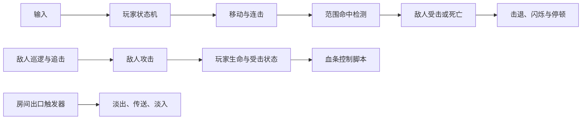

# 2D Dungeon RPG

**穿过地牢，用跳跃、冲刺与三段连击迎战怪物。**

基于 Unity 的 2D 横版动作 RPG 原型，围绕平台移动、近战战斗与房间探索展开。玩家与敌人采用有限状态机（FSM），便于逐步扩展动作和敌人行为。


[运行指南](docs/GETTING_STARTED.md) · [开发状态与路线](docs/PROJECT_STATUS.md) · [参与贡献](CONTRIBUTING.md) · [架构参考](PROJECT_REFERENCE.md)

## 游戏特色

- **平台移动**：平滑加减速、可变高度跳跃、冲刺、墙滑和墙跳。
- **近战战斗**：三段连击、受击击退、短暂无敌、震屏与命中停顿。
- **敌人行为**：骷髅与法师的巡逻、追击、攻击、受击和死亡状态，以及 Leviathan Boss 的独立状态实现。
- **关卡交互**：尖刺伤害与安全点回传、可破坏 Tilemap 门、黑屏过渡的房间传送。
- **表现与反馈**：玩家血量事件与血条控制脚本、冲刺残影、敌人受击闪烁、背景视差与 Cinemachine 摄像机。
- **动态刷怪**：根据玩家与生成点的距离生成、回收敌人。

> 当前处于原型开发阶段。以上为源码中已实现的系统；本次仓库文档整理经过静态核对，尚未进行 Unity 运行或构建验收。玩家自动复活、完整菜单与通关流程仍待完善，具体见[开发状态](docs/PROJECT_STATUS.md)。

## 快速开始

1. 安装 **Unity 2022.3.62f3c1**，版本以 [ProjectVersion.txt](ProjectSettings/ProjectVersion.txt) 为准。
2. 克隆仓库：

   ```bash
   git clone https://github.com/Wangwu-1/-2d-dungeon-rpg.git dungeon-rpg
   cd dungeon-rpg
   ```

3. 在 Unity Hub 中添加 `dungeon-rpg` 文件夹，等待 Package Manager 还原依赖、完成导入。
4. 打开 [Assets/Real.unity](Assets/Real.unity)，点击 **Play**，再点击 Game 窗口获得输入焦点。

Windows 构建步骤、依赖恢复及常见问题见[完整运行指南](docs/GETTING_STARTED.md)。

## 操作

| 操作 | 默认输入 |
| --- | --- |
| 左右移动 | `A` / `D` 或 `←` / `→` |
| 跳跃 / 墙跳 | `Space`；松开可缩短普通跳跃高度 |
| 冲刺 | `Left Shift` |
| 地面近战攻击 / 连击 | 鼠标左键 |

使用旧版 Input Manager。按键依据玩家状态脚本与 [InputManager.asset](ProjectSettings/InputManager.asset)；上下方向键不代表自由纵向移动。

## 系统如何协作



主战斗伤害通过 `Physics2D.OverlapCircleAll` 检测范围内目标；尖刺与房间出口使用 Trigger。玩家地面接触通过碰撞回调维护，墙体与敌人地形探测使用射线。详细实现见[架构参考](PROJECT_REFERENCE.md)，具体行为以代码为准。

## 目录导航

```text
Assets/
├── Real.unity           # 当前构建入口
├── Script/
│   ├── Player/          # 玩家、动作状态与动画桥接
│   ├── Enemy/           # 骷髅、法师、Leviathan 与敌人状态机
│   ├── GameManager/     # 房间传送与淡入淡出
│   ├── Spawner/         # 距离驱动的敌人生成与回收
│   ├── Hazards/         # 尖刺
│   ├── Interactables/   # 可破坏门
│   ├── Effects/         # 残影、闪烁与视差
│   └── UI/              # 玩家血条控制脚本
├── Editor/              # 关卡布置工具与 Windows 构建脚本
└── Prefabs/             # 可复用预制体
Packages/                # 包清单与依赖锁定
ProjectSettings/         # 场景、输入、Layer 与引擎版本
docs/                    # 运行、开发与验收指南
```

## 开发与贡献

从[贡献指南](CONTRIBUTING.md)开始。新增功能前说明影响的系统、状态机是否需要调整、是否需要新增状态；按[编码规范](docs/CODING_RULES.md)实现，并完成[验收清单](docs/REVIEW_CHECKLIST.md)。Bug 和功能建议可通过仓库的 [Issues](https://github.com/Wangwu-1/-2d-dungeon-rpg/issues) 提交。

## 素材与许可说明

仓库包含第三方美术资源，原有许可声明随资源保留。当前没有为整个项目指定统一开源许可证；代码与素材的使用范围请分别核对，不以公开仓库本身代替授权。资源索引见[第三方资源说明](docs/THIRD_PARTY_ASSETS.md)。
